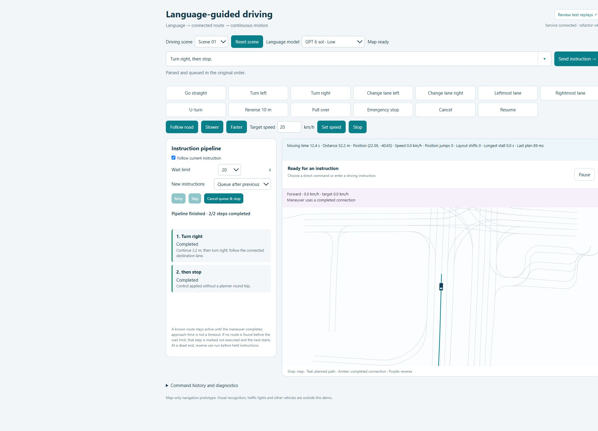

# Language-guided driving: follow ordered navigation instructions on real road maps.



## Problem

A self-driving planner should follow a human instruction such as “go straight,
then take the next right, change to the left lane, and stop after a given distance.”
The actions must happen in the stated order and connect to real nuPlan roads.
A trajectory predictor does not automatically expose an ordered language interface:
its likely futures may omit the requested maneuver, and selecting a route does not
establish that the requested sequence was executed. [Problem statement](docs/PROBLEM.md)

## Approach

| | Doh: language-guided MTR selection | Yushan: map-based navigation |
|---|---|---|
| Input | nuPlan scene history and map; doPlan language | Instruction, current vehicle state, nuPlan map |
| Method | Pretrained MTR candidates; proposed Word2Vec language scoring/selection | LLM → ordered actions → lane-graph search → timed geometric trajectory → instruction queue |
| Output | Selected candidate trajectory | Connected route and stateful browser playback |
| Status | Scorer not implemented/trained; code to be added by Hyungjun Doh | Working map-only prototype in `sim/` |

[Doh's track](approaches/mtr-selection/README.md) · [System architecture](docs/ARCHITECTURE.md)

Yushan first tried selecting MTR candidates too, but MTR predicts likely futures from scene history, so the requested maneuver was often not among its candidates; she switched to building the route directly from the map's lane graph, while Doh continues the MTR track.

## Demo / quick start

Install Node.js and Python, then run these commands from the repository root.
The Node server uses built-in modules. Python dependencies are listed in
[`sim/requirements.txt`](sim/requirements.txt).

```powershell
python -m venv .venv
.\.venv\Scripts\python.exe -m pip install -r sim/requirements.txt
node sim/server.cjs
```

Before planning, obtain the nuPlan map and place it at the path in
[DATA.md](docs/DATA.md). The default is
`data/nuplan/maps/us-nv-las-vegas-strip/9.15.1915/map.gpkg`, as recorded in
[`scene01.json`](sim/data/scenes/scene01.json).
On Linux/macOS, use `.venv/bin/python` for the install command.

Open <http://localhost:8775> for driving or <http://localhost:8775/review> for
the bundled recorded examples. If that port is already occupied, set
`$env:DEMO_PORT='8776'` before starting and open the corresponding address.
Use the direct maneuver buttons first; they do not need a language service.
Free text requires a locally configured provider CLI from
[`sim/parser/demo-models.json`](sim/parser/demo-models.json).
See [sim setup](sim/README.md) and [`.env.example`](.env.example).

```powershell
npm --prefix sim test
```

## What works / limits

- Ordered turns, lane changes, distance stops, speed commands, cancellation,
  and stateful playback are implemented; commands begin from the current pose.
- Geometry and vehicle footprints constrain routes. Search is bounded and may
  return waiting, blocked, or unsupported instead of a route.
- This is map-only: no obstacles, other traffic, traffic-rule enforcement,
  physics simulator, or real vehicle control.
- The **35 human road selections** are development references, not an independent
  benchmark. The original comparison script identifies their scope and source
  files: [`human_review_regression.py`](sim/tests/unit/human_review_regression.py).
- Recorded examples demonstrate behavior; they do not establish general success
  rates or a measured improvement over MTR. [Evaluation and limits](docs/EVALUATION.md)

## Repository map

```text
README.md             Problem, parallel approaches, quick start
LICENSE               MIT for project code; external data keeps its own terms
.gitignore            Keep environments, large resources, and runtime output local
.env.example          Portable runtime configuration
docs/                 Problem, architecture, data, evaluation, selected figures
approaches/           Doh's MTR selection track
sim/                  Current application, parser, scene metadata, tests, review subset
```

ECE191 · Group 4 · Yushan Xian and Hyungjun Doh.
