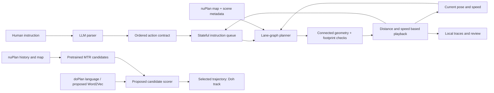

# Architecture

**Language interface.** `sim/parser/parser_backends.py` invokes a configured local
provider CLI. The prompt and model catalog live alongside it. All responses use
`sim/engine/schema.json`, the single instruction contract. Semantic cleanup
preserves explicit conditions; normalization translates supported actions into
the planner's representation. Direct control buttons bypass the LLM.

**Scene and map.** `engine/scene.py` reads small exported scene metadata and
`map_data.py` reads the external nuPlan map. Localization, projection, and an
initial-pose transform put map geometry in scene-local coordinates. Topology
groups lanes and junction movements, including geometrically checked completed
connections; these are not claims about legal traffic movements.

**Planning and geometry.** `engine/planner.py` dispatches to turn, lane-change,
recovery, reverse, and route modules. Search is bounded. Geometry checks reject
discontinuous curves and apply vehicle-footprint constraints. A successful
response includes route geometry, maneuver bounds, and completion conditions.

**Queue and playback.** `web/pipeline.js` owns instruction states and ordering;
`web/motion.js` advances along route distance using elapsed time and speed.
Cancellation, replacement, pauses, and stale asynchronous replies are explicit.
This is geometric playback, not a physics simulation.

**Service and review.** `server.cjs` serves the UI and delegates planning to a
persistent Python worker. `review-api.cjs` serves the bundled replays and stores
new local ratings under `logs/reviews/`. No existing rating collection is used.

**Parallel MTR track.** Doh proposes language-based scoring of pretrained MTR
candidates. Its scorer is not implemented/trained here. No further architecture
or performance is claimed. See [the approach note](../approaches/mtr-selection/README.md).
