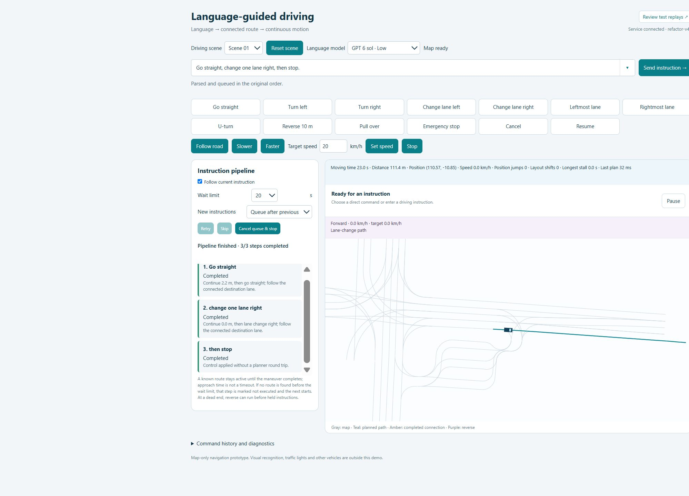
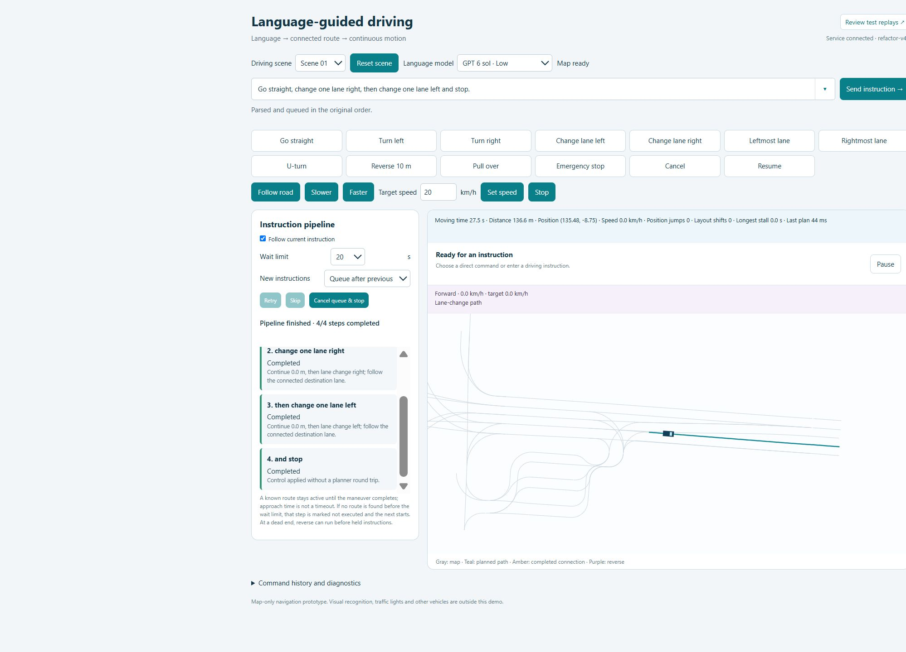

# Evaluation and honest limits

The fast unit tier checks browser-independent queue state, timing, motion,
stopping, cancellation, and review persistence. Synthetic geometry and parser
contract checks exercise Python code without the external map. Run
`npm --prefix sim test`; see [test commands](../sim/tests/README.md).

Map regressions exercise actual lane geometry and route continuity. They need
the external nuPlan map and are opt-in because loading and searching real scenes
is slower than unit tests. Historical tests that also need excluded experimental
outputs are preserved with their prerequisites identified, not silently reported
as passing or treated as part of the portable fast tier.

Browser gates inspect actual journeys, phase order, destinations, and movement.
Recorders and audit scripts live under `sim/tests/browser/`. The review page
replays the bundled recordings without replanning. Human scores are local and
separate from the source recordings. A recorded successful demonstration is not
an independent evaluation of unseen instructions or scenes.

The 35 original human road selections are development references. The source
list and loop over scenes/actions are retained in
[`human_review_regression.py`](../sim/tests/unit/human_review_regression.py).
Those reviews guided development and are not a held-out benchmark. No measured
percentage improvement over MTR has been established.

Future comparison should use shared scenes and instructions, action completion
in order, road fit, planning latency, and explicit failure categories. ADE/FDE
are meaningful only with an appropriate matched recorded future; a valid
alternative commanded route may intentionally differ from the recorded drive.

The current system has no obstacle interaction, traffic-rule model, physics
simulation, or real-vehicle validation. Bounded search can miss a reachable
route. Geometry checks do not establish driving safety. Provider availability
and language interpretation are separate from deterministic planner tests.

Repository preparation checks on 2026-10-27: the fast entry point passed 37
JavaScript and 10 Python tests; the real-map semantic regression passed 9 cases;
the browser smoke check passed 4 checks. The isolated service on port 8776
returned a healthy response, loaded scene 1, and planned `go_straight`.
Python tests used the existing WSL environment read-only. Scene metadata matched
all seven original origin/projection/start-pose records. These are engineering
checks, not an LLM accuracy or driving-success benchmark. Live provider calls,
the full historical experiment suite and a fresh dependency installation were
not tested; provider adapters were exercised with controlled replies.

Selected historical UI examples (not new benchmark results), copied from
`refactor-v40/results/example-04.png`, `example-05.png`, and `example-06.png`.
The first is the README hero; the remaining two are shown below.

